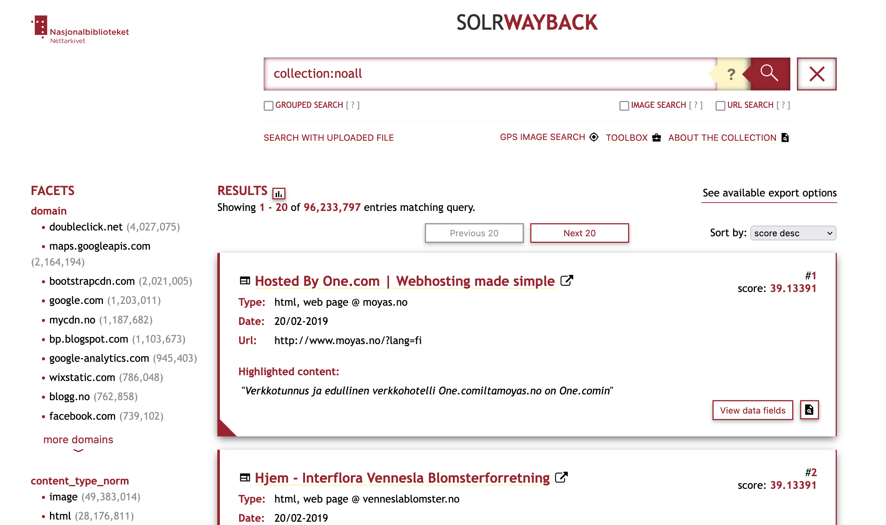

# Search
SolrWayback provides advanced and powerful features to search and examine the Norwegian Web Archive.
{: .fs-6 .fw-300 }

This section provides an overview of SolrWayback's different search modes, its search syntax, and an extensive list of the different index fields you can search through.
